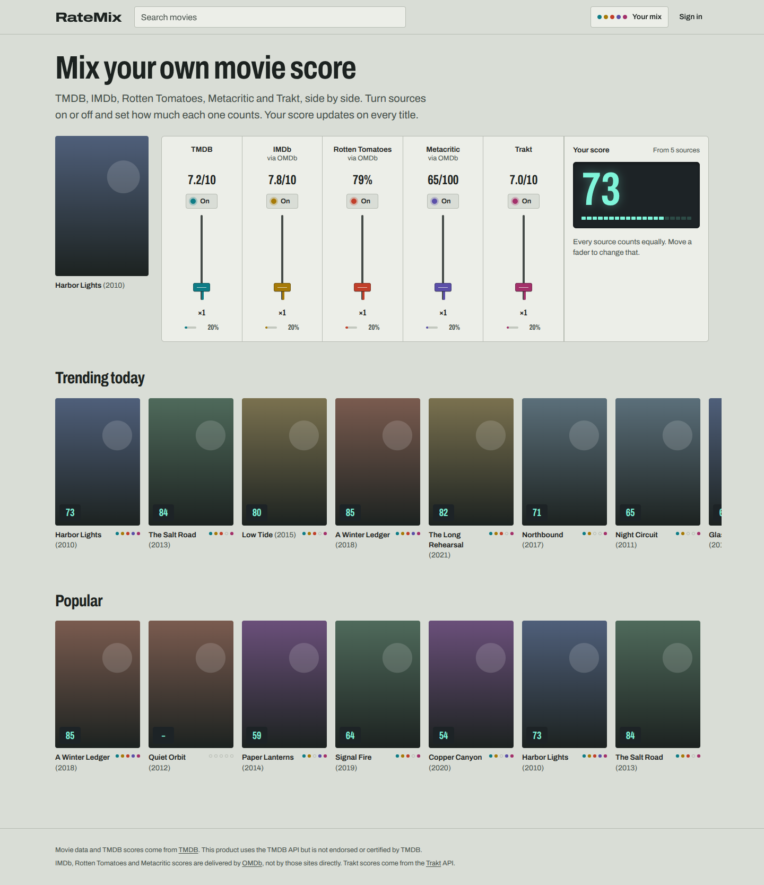

# RateMix

A movie site that shows ratings from TMDB, IMDb, Rotten Tomatoes, Metacritic and Trakt side by side, and lets
each person mix them into a score of their own. Sources can be switched on or off and weighted; the score
recomputes instantly in the browser.



<sub>Screenshots use invented fixture titles and placeholder posters.</sub>

## Contents

- [Stack](#stack)
- [Quick start (Windows)](#quick-start-windows)
- [Getting API keys](#getting-api-keys)
- [Scripts](#scripts)
- [How it works](#how-it-works)
- [Testing](#testing)
- [Deployment](#deployment)
- [Adding a rating source](#adding-a-rating-source)
- [Where this differs from the technical plan](#where-this-differs-from-the-technical-plan)
- [Known limitations and next steps](#known-limitations-and-next-steps)
- [Data sources and terms](#data-sources-and-terms)

## Stack

| Layer          | Choice                                                                        |
| -------------- | ----------------------------------------------------------------------------- |
| Frontend       | Vue 3.5, TypeScript, Vite 8, Pinia 4 (+ persisted state), Vue Router 5        |
| UI             | Tailwind CSS 4, Reka UI (the successor to Radix Vue), Archivo variable font   |
| API            | NestJS 11 with tRPC 11 (end-to-end types, no codegen), Zod 4                  |
| Data           | PostgreSQL via Prisma 7 (node-postgres driver adapter), Redis                 |
| Ingestion      | BullMQ 6 workers and Job Schedulers                                           |
| Auth           | Email/password (bcrypt), JWT access tokens, rotating httpOnly refresh cookies |
| Optional OAuth | GitHub and Google                                                             |
| Tests          | Vitest 5 (unit), Playwright (end-to-end)                                      |
| Tooling        | pnpm 12 workspaces, ESLint 10, Prettier, GitHub Actions, Docker               |
| Observability  | Sentry (API and web, off unless a DSN is set), pino structured logs           |

```
Movieaggregator/
├── apps/
│   ├── api/          NestJS API gateway + ingestion workers (one codebase, two entrypoints)
│   │   ├── prisma/   schema.prisma and migrations
│   │   └── src/
│   │       ├── sources/     Adapter interface + TMDB, OMDb, Trakt adapters, OMDb daily quota
│   │       ├── catalog/     Ratings repository, Redis movie cache, queues, refresh policy
│   │       ├── workers/     BullMQ workers, scheduler, job runner
│   │       ├── movies/      Search, detail, lists
│   │       ├── preferences/ Per-user source preferences
│   │       ├── auth/        Password auth, refresh-token rotation, OAuth
│   │       └── trpc/        Routers (framework-agnostic) + NestJS bridge
│   └── web/          Vue SPA
│       ├── src/components/  Mixer console, channel strips, cards, readouts
│       ├── src/stores/      Pinia: preferences, auth, sync, movie cache
│       └── e2e/             Playwright tests with a mocked tRPC API
├── packages/
│   └── shared/       Source catalog, normalization, composite-score math, DTOs, Zod schemas
├── docker-compose.yml
└── .github/workflows/  ci.yml, deploy.yml
```

The composite-score formula lives in `packages/shared`, so the API and the browser run the exact same code.

## Quick start (Windows)

You need **Node.js 22 LTS or newer** ([nodejs.org](https://nodejs.org)) and **Docker Desktop**
([docker.com](https://www.docker.com/products/docker-desktop/)) for Postgres and Redis. Run these in PowerShell.

**1. Put the project in place and install dependencies**

```powershell
cd D:\JS\Movieaggregator
corepack enable          # if this fails, run PowerShell as Administrator once, or: npm install -g pnpm@12
pnpm install
```

`pnpm install` also builds the shared package and generates the Prisma client. The first run downloads
Prisma's schema engine, which needs internet access.

**2. Configure the API**

```powershell
Copy-Item apps\api\.env.example apps\api\.env
node -e "console.log(require('crypto').randomBytes(48).toString('base64url'))"
```

Open `apps\api\.env`, paste the generated value into `JWT_ACCESS_SECRET`, and add your API keys
([how to get them](#getting-api-keys)). Only `TMDB_API_KEY` is needed to see movies; OMDb and Trakt add more
sources. The web app needs no configuration for local development.

**3. Start Postgres and Redis, then create the database tables**

```powershell
pnpm db:up
pnpm db:migrate
```

**4. Run everything**

```powershell
pnpm dev
```

Open **http://localhost:5173**. The API runs on port 3000 with the ingestion workers in the same process. On
first start the workers pull TMDB's trending and popular lists, and scores fill in within a few seconds.

To stop: press `Ctrl+C`, then `pnpm db:down` (your data stays in Docker volumes).

### Troubleshooting

| Symptom                                                 | Fix                                                                                                                 |
| ------------------------------------------------------- | ------------------------------------------------------------------------------------------------------------------- |
| `Invalid environment configuration` when the API starts | The message lists each bad variable. Usually `JWT_ACCESS_SECRET` is shorter than 32 characters.                     |
| Home page says the catalog is empty                     | `TMDB_API_KEY` is missing from `apps\api\.env`. Restart `pnpm dev` after adding it.                                 |
| `Can't reach database server` / Redis errors            | Docker Desktop isn't running, or `pnpm db:up` wasn't run. Check with `docker compose ps`.                           |
| Ports 5432 or 6379 already in use                       | Another Postgres/Redis is running locally. Stop it, or change the port mappings in `docker-compose.yml` and `.env`. |
| Rotten Tomatoes/Metacritic show "No score"              | Normal for some titles: OMDb doesn't include them for every film.                                                   |
| `ERR_PNPM_IGNORED_BUILDS` during install                | A new dependency wants to run an install script. Add it to `allowBuilds` in `pnpm-workspace.yaml`.                  |

## Getting API keys

All three are free for non-commercial use.

| Key               | Where                                                                  | Notes                                                                                         |
| ----------------- | ---------------------------------------------------------------------- | --------------------------------------------------------------------------------------------- |
| `TMDB_API_KEY`    | [themoviedb.org/settings/api](https://www.themoviedb.org/settings/api) | Either the v3 "API Key" or the v4 "API Read Access Token" works. Required for the catalog.    |
| `OMDB_API_KEY`    | [omdbapi.com/apikey.aspx](https://www.omdbapi.com/apikey.aspx)         | Free tier is 1,000 requests/day; activate the key from the confirmation email.                |
| `TRAKT_CLIENT_ID` | [trakt.tv/oauth/applications](https://trakt.tv/oauth/applications)     | Create an app; use `urn:ietf:wg:oauth:2.0:oob` as redirect URI. Only the Client ID is needed. |

Optional sign-in providers (buttons appear only when both values are set):

- **GitHub**: [github.com/settings/developers](https://github.com/settings/developers) → New OAuth App. Callback URL
  `http://localhost:5173/auth/oauth/github/callback`.
- **Google**: Google Cloud Console → Credentials → OAuth client ID (Web application). Redirect URI
  `http://localhost:5173/auth/oauth/google/callback`.

## Scripts

Run from the repository root.

| Command           | What it does                                                                          |
| ----------------- | ------------------------------------------------------------------------------------- |
| `pnpm dev`        | Shared package (watch), API with in-process workers (watch), Vite dev server          |
| `pnpm build`      | Builds shared, API and web                                                            |
| `pnpm typecheck`  | TypeScript across all packages (the web check includes the API router types)          |
| `pnpm lint`       | ESLint                                                                                |
| `pnpm format`     | Prettier                                                                              |
| `pnpm test`       | Unit tests in every package                                                           |
| `pnpm test:e2e`   | Playwright (first run: `pnpm --filter @ratemix/web exec playwright install chromium`) |
| `pnpm db:up`      | Start Postgres and Redis in Docker                                                    |
| `pnpm db:migrate` | Apply migrations (and create new ones after schema changes)                           |
| `pnpm db:studio`  | Prisma Studio, a browser UI for the database                                          |

Run the API and worker as separate processes, as in production:

```powershell
pnpm --filter @ratemix/api build
# in apps\api\.env set RUN_WORKERS=false, then in two terminals:
pnpm --filter @ratemix/api start
pnpm --filter @ratemix/api start:worker
```

## How it works

### Request path never waits on rating APIs

```
Vue SPA ──tRPC──▶ NestJS API ──▶ Redis cache ──▶ Postgres
                     │ enqueue
                     ▼
               BullMQ (Redis) ──▶ Workers ──▶ TMDB / OMDb / Trakt
```

The API serves ratings from its own database. When someone opens a title that hasn't been ingested, the API
fetches TMDB details synchronously (TMDB is the catalog and is fast), then **enqueues** OMDb and Trakt fetches
and returns immediately with `ratingsPending: true`. The page shows loading placeholders and polls until the
workers finish. A provider being down or rate-limited never breaks a page; its card just says why.

### Normalization and the composite score

Every raw score is converted to 0–100 at ingestion time (`7.8/10 → 78`, `91% → 91`) and stored next to the raw
value. The composite is:

```
score = Σ(normalized_i × weight_i) / Σ(weight_i)   over enabled sources that rate the title
```

Because the browser already has every source's normalized value, moving a fader recomputes locally with no
request. Guests keep preferences in `localStorage`; signed-in users sync them (debounced) to Postgres.

### Ingestion schedule and the OMDb budget

- **On demand:** opening a title enqueues whatever it's missing at the highest priority. TMDB runs first when
  the IMDb ID is unknown, because OMDb and Trakt look titles up by IMDb ID.
- **Scheduled:** an hourly Job Scheduler re-fetches titles whose interval has elapsed. Trending/popular titles
  and releases from the last 60 days refresh every 6 h, releases from the last year every 12 h, older titles
  every 24 h (all configurable). Only titles someone viewed in the last 30 days or that are on a list are
  refreshed, so the budget isn't spent on search results nobody opened.
- **Catalog sync:** every 6 hours the worker pulls TMDB's trending and popular lists.
- **OMDb quota:** an atomic Redis counter enforces `OMDB_DAILY_LIMIT` (default 950, leaving headroom below
  1,000). Background work may use only `OMDB_SCHEDULED_SHARE` (70%) of it and is spread evenly over the day,
  which keeps budget available for titles people open late in the day. If OMDb itself reports the limit, the
  counter is corrected and the queue pauses until the next UTC day.
- **Rate limits:** each provider has its own queue with concurrency and request-rate limits. HTTP 429 pauses
  that queue for the `Retry-After` period. Transient failures retry with exponential backoff; invalid API keys
  fail immediately without retries.

### Caching

Movie snapshots (metadata, ratings, provider status) are cached in Redis and invalidated on every ingestion
write. Keys also carry a 7-day TTL as a memory safety net, because BullMQ requires Redis's `noeviction` policy.
TMDB search responses are cached for 6 hours. If Redis is unavailable, reads fall back to Postgres.

### Auth

- Access tokens are short-lived JWTs kept in memory only.
- Refresh tokens are random, stored as SHA-256 hashes, sent as an httpOnly cookie scoped to `/trpc`, and rotated
  on every use. Reusing an already-rotated token revokes all of that user's sessions, with a 30-second grace
  window so two tabs refreshing at once aren't mistaken for theft.
- Login and registration are rate limited per IP.
- OAuth accounts are never linked to an existing account by email, which prevents account pre-hijacking.
- On sign-in, if both this browser and the account have different custom mixes, the app asks which to keep.

## Testing

```powershell
pnpm test       # shared, API and web unit tests
pnpm test:e2e   # Playwright, desktop and mobile viewports
```

- **Shared:** normalization, the composite formula, preference resolution and input validation.
- **API:** each adapter against mocked HTTP (including OMDb coverage gaps, quota exhaustion, invalid keys and Trakt
  429s), the refresh policy, the job runner, env validation, OAuth exchanges, and the tRPC router via
  `createCaller`.
- **Web:** the mixer component, the preferences store and the sign-in merge decision.
- **End to end:** switching a source off and raising a weight recompute the score with no network request; a
  guest mix survives a reload; the mixer drawer changes the score on the page behind it. These tests mock the
  tRPC API in the browser, so they need no database or API keys.

## Deployment

The plan's target: static SPA on Vercel or Netlify, API and worker on Fly.io (or Railway, or a VPS), managed
Postgres (Neon, Supabase, RDS) and managed Redis (Upstash, Redis Cloud).

**Keep the refresh cookie first-party.** The simplest way is to have the SPA host proxy `/trpc` and
`/auth/oauth` to the API. `apps/web/vercel.json` and `apps/web/netlify.toml` already do this; replace
`ratemix-api.fly.dev` with your API host. If you call the API cross-site instead, set `VITE_API_URL` when
building the web app and `COOKIE_SAMESITE=none`, `COOKIE_SECURE=true` on the API.

**API on Fly.io** (see comments in `apps/api/fly.toml`):

```powershell
fly launch --no-deploy --config apps/api/fly.toml
fly secrets set DATABASE_URL=... REDIS_URL=... JWT_ACCESS_SECRET=... TMDB_API_KEY=... OMDB_API_KEY=... TRAKT_CLIENT_ID=... FRONTEND_URL=https://your-site CORS_ORIGINS=https://your-site OAUTH_REDIRECT_BASE_URL=https://your-site --config apps/api/fly.toml
fly deploy . --config apps/api/fly.toml --dockerfile apps/api/Dockerfile
```

Migrations run as the release command. The same image runs the `app` and `worker` process groups.

**Vercel:** import the repository, set the root directory to `apps/web`, and add the environment variable
`ENABLE_EXPERIMENTAL_COREPACK=1` so the pinned pnpm version is used.

**Everything in Docker** (production-like, on one machine or a VPS):

```powershell
docker compose --profile full up --build
```

This starts Postgres, Redis, a one-off migration, the API, a separate worker and nginx serving the SPA on
http://localhost:8080. It reads `apps\api\.env` and requires a real `JWT_ACCESS_SECRET`: the API refuses the
placeholder value in production.

**CI/CD:** `ci.yml` runs lint, format check, typecheck, unit tests, build and Playwright on every pull request.
`deploy.yml` runs on pushes to `main`: CI, then Docker images pushed to GitHub Container Registry, then a Fly.io
deploy if the `FLY_API_TOKEN` repository secret exists.

## Adding a rating source

1. Add the source to `SOURCE_IDS` and `SOURCE_CATALOG` in `packages/shared/src/sources.ts` (and its provider to
   `PROVIDER_IDS`/`PROVIDERS` if it's a new API). The `rating_sources` table is synced from this catalog on startup.
2. Implement `RatingSourceAdapter` in `apps/api/src/sources/<provider>/`: fetch, normalize, return. Adapters
   don't touch the database.
3. Register it in `AdapterRegistry` and give it rate limits in `WORKER_LIMITS` (`workers.service.ts`).
4. Add a channel color `--color-ch-<source>` in `apps/web/src/styles/main.css`.

Nothing in aggregation, the API surface or the UI needs other changes.

## Where this differs from the technical plan

| Plan                                          | Implementation                                                                        | Why                                                                                                                            |
| --------------------------------------------- | ------------------------------------------------------------------------------------- | ------------------------------------------------------------------------------------------------------------------------------ |
| One adapter returns one source                | One adapter may return several                                                        | A single OMDb call yields IMDb, Rotten Tomatoes and Metacritic; one adapter per source would triple use of the tightest quota. |
| `movies.getById(id)`                          | `movies.getById({ tmdbId })`                                                          | TMDB IDs make shareable URLs and let a title that was never ingested be imported on first visit.                               |
| Auth.js or JWT                                | JWT + rotating refresh tokens in NestJS                                               | Fits a separate SPA and API better than Auth.js's framework adapters.                                                          |
| Headless UI or Radix Vue                      | Reka UI                                                                               | Radix Vue's successor; Headless UI for Vue has no slider, which the weight controls need.                                      |
| Core tables                                   | Plus `movie_provider_sync`, `movie_list_entries`, `refresh_tokens`, and a few columns | Ingestion bookkeeping ("ratings loading" states, scheduling), trending/popular lists, secure sessions.                         |
| Invalidate cache instead of time-based expiry | Invalidation plus a 7-day safety TTL                                                  | BullMQ needs Redis `noeviction`, so unbounded keys could exhaust memory.                                                       |
| NestJS (latest)                               | NestJS 11 rather than 12                                                              | Sentry's NestJS SDK doesn't support 12 yet.                                                                                    |
| TypeScript (latest)                           | TypeScript 6.0 rather than 7                                                          | typescript-eslint doesn't support TypeScript 7 yet.                                                                            |

## Known limitations and next steps

- **Letterboxd** isn't integrated; its API is request-only. The adapter pattern is ready for it.
- **Mismatched IMDb IDs** (remakes, regional cuts) are detected and logged, but there's no admin tool yet to
  correct them.
- **OMDb's daily reset time** isn't documented; the quota assumes midnight UTC.
- **Email verification and password reset** aren't implemented.
- **Stretch goals from the plan:** watch-provider info (TMDB has it) and recommendations based on your own
  composite scores.

## Data sources and terms

This product uses the TMDB API but is not endorsed or certified by TMDB. IMDb, Rotten Tomatoes and Metacritic
numbers are delivered by OMDb, not by those sites, and the UI labels them that way. Nothing in this project
scrapes Rotten Tomatoes, Metacritic, IMDb or Letterboxd.

Review the TMDB, OMDb and Trakt terms before any commercial or public production use. Commercial use of TMDB
requires a separate agreement, and republishing Rotten Tomatoes or Metacritic numbers relies on OMDb's
arrangements with those parties. This is not legal advice.
# movie-aggregator

# movie-aggregator

